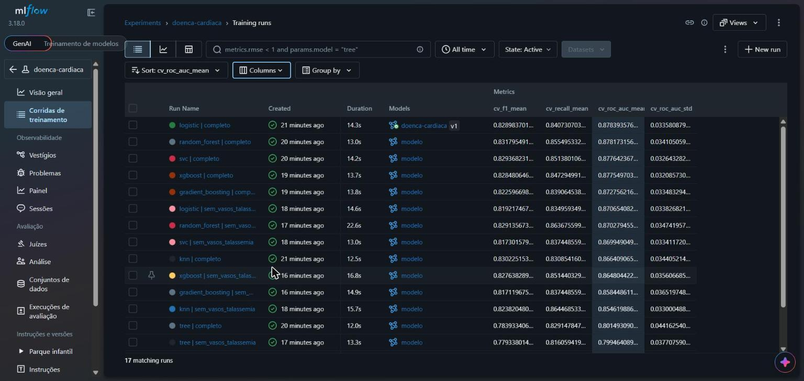
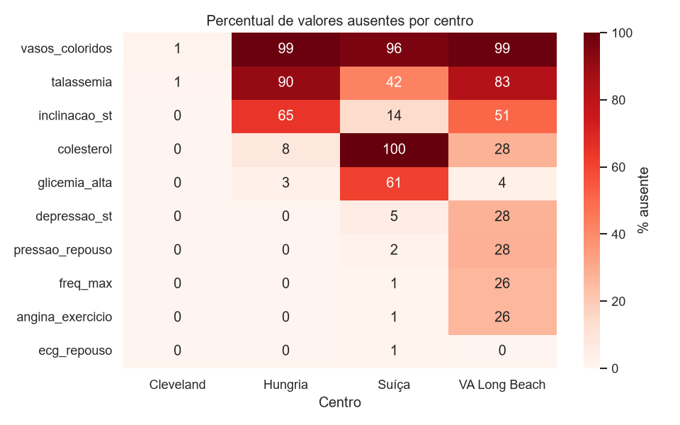
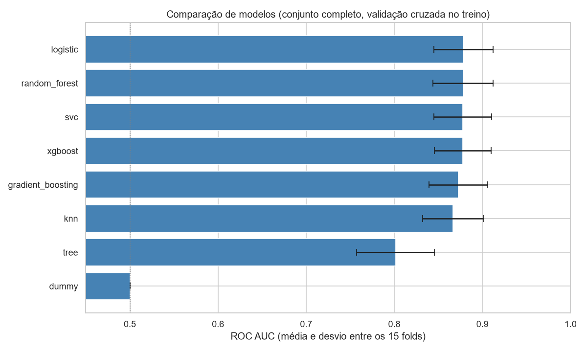
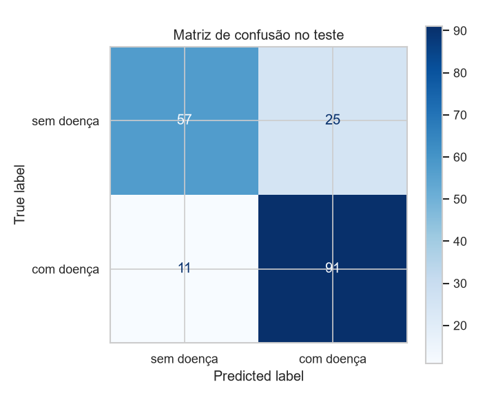
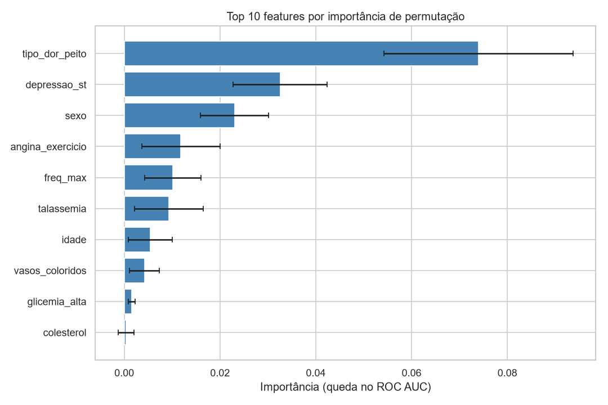

# Doença cardíaca: comparação de modelos com MLflow

Classificação de doença arterial coronariana com a base UCI Heart Disease (920 pacientes de 4 hospitais). Comparei 8 modelos em 2 conjuntos de variáveis, registrei tudo no MLflow e publiquei o vencedor no Model Registry com um limiar escolhido para triagem.



## A pergunta

Dado o exame de um paciente (idade, tipo de dor no peito, frequência cardíaca máxima no teste de esforço, depressão do segmento ST etc.), dá para estimar se ele tem estreitamento arterial confirmado no cateterismo?

Como é triagem, errar para o lado de deixar um doente passar custa mais do que um falso alarme. Por isso a métrica que guiou a decisão final foi o recall da classe doente, com o ROC AUC para comparar modelos.

## Os dados

[UCI Heart Disease](https://archive.ics.uci.edu/dataset/45/heart+disease), licença CC BY 4.0. Junta quatro estudos de 1988: Cleveland (303 pacientes), Hungria (294), Suíça (123) e VA Long Beach (200). O alvo original `num` vai de 0 a 4 e eu transformei em sim/não (`num > 0`). 55% da base tem doença.

A base parece simples, mas tem uma armadilha que tomou boa parte do trabalho:



Cada hospital mediu coisas diferentes. A Suíça não registrou colesterol de ninguém (vinha como 0). `vasos_coloridos` e `talassemia` praticamente só existem em Cleveland. E a proporção de doentes muda muito de um centro para outro: 36% na Hungria, 93% na Suíça.

Resultado: o hospital de origem "prevê" o alvo sem dizer nada sobre o paciente. Tirei a coluna `origem` das variáveis, mas ela continua vazando pelos faltantes. Os 202 pacientes sem colesterol têm 80,7% de doença, contra 48,2% dos que têm a medida. Isso está detalhado no [notebook de exploração](notebooks/01_exploracao.ipynb) e pesou em quase todas as decisões abaixo.

## O que fiz

- `data/baixar_dados.py` baixa o zip oficial da UCI e junta os 4 arquivos `processed.*.data`.
- `src/preparo.py` traduz os códigos para rótulos legíveis, trata colesterol e pressão iguais a 0 como ausentes e remove 2 linhas duplicadas.
- Separei 20% para teste (estratificado pelo alvo) e não toquei nele até o final.
- Imputação (mediana nas numéricas, moda nas categóricas), padronização e one-hot ficam dentro do `Pipeline`, então são ajustados só com dados de treino em cada fold. Não usei indicador de ausência de propósito: ele reconstruiria o hospital.
- `src/treinar.py` roda 8 modelos (Dummy como linha de base, regressão logística, KNN, SVM, árvore, random forest, gradient boosting e XGBoost), cada um com uma grade pequena de hiperparâmetros (GridSearchCV, 5 folds). O melhor de cada um passa por validação cruzada repetida (5 folds x 3 repetições). Fiz isso duas vezes: com todas as variáveis e sem `vasos_coloridos`/`talassemia`, que são quase só de Cleveland. São 16 runs no MLflow, cada um com parâmetros, métricas e o modelo salvo.
- `src/avaliar.py` pega o melhor run, escolhe o limiar de decisão com previsões out-of-fold no treino, avalia uma única vez no teste e registra o modelo como `doenca-cardiaca@champion`.
- `src/prever.py` carrega o champion do registry e classifica um CSV novo.

## Resultados

### Comparação na validação cruzada (treino, 734 pacientes)

| Modelo | ROC AUC (média) | desvio entre folds |
|---|---|---|
| Regressão logística | 0,878 | 0,034 |
| Random forest | 0,878 | 0,034 |
| SVM | 0,878 | 0,033 |
| XGBoost | 0,878 | 0,032 |
| Gradient boosting | 0,873 | 0,033 |
| KNN | 0,866 | 0,034 |
| Árvore de decisão | 0,801 | 0,044 |
| Dummy | 0,500 | 0,000 |



Os quatro primeiros empatam. A regressão logística ficou na frente por 0,0002, o que é ruído puro perto de um desvio de 0,03. Com empate, fiquei com ela por ser a mais simples de explicar e de manter, e porque devolve probabilidades em que o limiar funciona bem. Gradient boosting e KNN também ficam dentro da faixa de variação. Só a árvore sozinha fica claramente atrás.

Tirar `vasos_coloridos` e `talassemia` custou pouco (logística foi de 0,878 para 0,871), também dentro do ruído.

### Teste (184 pacientes que o modelo nunca viu)

Limiar de 0,40: o maior valor que mantinha recall de pelo menos 90% nas previsões out-of-fold do treino.

| Métrica | Valor | IC 95% (bootstrap) |
|---|---|---|
| ROC AUC | 0,899 | 0,85 a 0,94 |
| Recall | 0,892 (91 de 102 doentes) | 0,83 a 0,95 |
| Precisão | 0,784 (91 de 116 alertas) | |
| Acurácia | 0,804 | |

O recall ficou um pouco abaixo dos 90% que serviram de alvo. É o esperado quando o limiar é escolhido bem na borda, e 0,90 está dentro do intervalo. 11 doentes passaram sem alerta e 25 pessoas sem doença foram sinalizadas.



Como o AUC geral mistura hospitais com prevalências muito diferentes, separei o teste por centro:

| Centro | Pacientes no teste | Doentes | ROC AUC |
|---|---|---|---|
| Cleveland | 55 | 26 | 0,943 |
| Hungria | 64 | 22 | 0,886 |
| VA Long Beach | 38 | 27 | 0,842 |
| Suíça | 27 | 27 | não dá para calcular (só doentes) |

O modelo continua separando bem dentro de cada hospital, então o 0,899 não é só efeito de misturar centros.

### E num hospital novo?

Para ver isso, treinei o mesmo modelo em 3 hospitais e testei no quarto.

| Hospital fora do treino | ROC AUC | Recall (limiar 0,40) |
|---|---|---|
| Cleveland | 0,845 | 0,928 |
| Hungria | 0,892 | 0,943 |
| VA Long Beach | 0,735 | 0,865 |
| Suíça | 0,754 | 0,774 |

Aqui o desempenho cai e varia bastante. VA e Suíça são justamente os centros com mais dados faltando. Um aviso sobre esse teste: modelo, hiperparâmetros e limiar foram escolhidos com os 4 hospitais no treino, então ele funciona mais como diagnóstico do que como validação. Mesmo assim, deixa claro que o modelo não está pronto para ser usado em um hospital diferente sem recalibrar.

### O que mais pesa



Tipo de dor no peito é de longe a variável mais importante, seguida de depressão ST, sexo, angina no exercício e frequência máxima. Bate com a exploração: pacientes assintomáticos têm 79% de doença, porque quem chega ao cateterismo sem sintoma normalmente foi encaminhado por outro sinal forte. O colesterol quase não contribui.

## Limitações

- A validação cruzada usada para comparar modelos é a mesma em que os hiperparâmetros foram ajustados (não é aninhada), então os 0,878 são um pouco otimistas, mais para os modelos com grade maior. O teste separado serve de checagem.
- Imputar `vasos_coloridos` e `talassemia` pela moda faz o modelo enxergar "normal" em pacientes de três hospitais que nunca fizeram esse exame.
- Os dados são de 1988, de quatro centros específicos. Nada aqui foi validado para uso clínico.
- A importância por permutação foi calculada em 184 pacientes e oscila bastante entre repetições (ver barras de erro).

## Como rodar

```bash
python -m venv .venv
.venv\Scripts\activate        # Linux/Mac: source .venv/bin/activate
pip install -r requirements.txt

python data/baixar_dados.py
python -m src.treinar          # ~6 min, 16 runs
python -m src.avaliar
python -m src.prever data/exemplo_pacientes.csv

mlflow ui --backend-store-uri sqlite:///mlflow.db
```

Testado com Python 3.12. As versões estão fixas no `requirements.txt` porque o jeito de salvar modelos mudou no MLflow 3.

## Estrutura

```
data/baixar_dados.py        download da UCI
data/exemplo_pacientes.csv  5 pacientes para testar o prever
notebooks/01_exploracao.ipynb
src/preparo.py              limpeza e split
src/treinar.py              comparação de modelos no MLflow
src/avaliar.py              limiar, teste, registry, figuras
src/prever.py               previsão com o champion
reports/                    tabelas e figuras geradas
```

## Fonte

Janosi, A., Steinbrunn, W., Pfisterer, M., & Detrano, R. (1989). Heart Disease [Dataset]. UCI Machine Learning Repository. https://doi.org/10.24432/C52P4X
